<picture>
  <source media="(prefers-color-scheme: dark)" srcset="assets/banner-dark.svg">
  <source media="(prefers-color-scheme: light)" srcset="assets/banner-light.svg">
  
</picture>

<p align="center">Full stack developer · Android and machine learning</p>

```text
nigmu@profile:~$ whoami
Nigam
nigmucode@gmail.com

nigmu@profile:~$ now
TrackMySpend
resume-ledger
bg_download

nigmu@profile:~$ fun-fact
I can play a ukulele.
```

## Selected work

<h3>
  
  <a href="https://github.com/nigmu/TrackMySpend">TrackMySpend</a>
</h3>

FastAPI and PostgreSQL service that records Android bank SMS into a ledger, with a static web UI and a Kotlin companion.

<h3>
  
  <a href="https://github.com/nigmu/resume-ledger">resume-ledger</a>
</h3>

Agent-driven system that turns a career log into a tailored, evidence-based Word and PDF resume for each job.

<h3>
  
  <a href="https://github.com/nigmu/Clean_TV_MiTV-MOOQ0">Clean_TV_MiTV-MOOQ0</a>
</h3>

Java Android TV home screen and debloat tools for a Xiaomi Mi TV (MiTV-MOOQ0).

<h3>
  
  <a href="https://github.com/nigmu/odia-STT">odia-STT</a>
</h3>

Tkinter desktop app that records speech and transcribes Odia into Unicode text with ElevenLabs Scribe v2.

<h3>
  
  <a href="https://github.com/nigmu/bg_download">bg_download</a>
</h3>

Python tools that fetch Wallhaven stills and replace KDE Plasma live-wallpaper slots from Pixabay and Coverr.

<h3>
  
  <a href="https://github.com/nigmu/warehouse_management">warehouse_management</a>
  ·
  <a href="https://github.com/nigmu/WMS_DEPLOY_FRONTEND">WMS_DEPLOY_FRONTEND</a>
</h3>

Django REST framework and PostgreSQL backend for a warehouse management system, with a React, Vite, and Tailwind frontend.

<details>
<summary>Notebooks and practice</summary>

<br>

[nigmu-parkinsons_disease_prediction](https://github.com/nigmu/nigmu-parkinsons_disease_prediction) — PyTorch notebooks that train a small CNN on healthy-control and Parkinson's images.

[neetcode-submissions](https://github.com/nigmu/neetcode-submissions) — Python solutions synced from NeetCode.io.

</details>

## Public code, by bytes

<!-- languages:start -->
```text
public repository bytes, forks excluded

Jupyter Notebook  ██████████░░░░░░   63.9%
Python            ██░░░░░░░░░░░░░░   10.4%
Java              █░░░░░░░░░░░░░░░    9.0%
HTML              █░░░░░░░░░░░░░░░    5.5%
CSS               █░░░░░░░░░░░░░░░    4.8%
JavaScript        █░░░░░░░░░░░░░░░    3.7%
Kotlin            █░░░░░░░░░░░░░░░    1.4%
PowerShell        █░░░░░░░░░░░░░░░    0.7%
Other             █░░░░░░░░░░░░░░░    0.6%
```
<!-- languages:end -->

Share of bytes in public repositories. Forks are excluded. Notebooks are counted with everything else, so Jupyter can outweigh smaller projects.

## Toolbox

<p>
  
  
  
  
  
  
  
  
  
  
  
  
  
  
  
  
  
  
  
  
  
  
  
</p>

## Reach

Looking to collaborate on open-source projects. Ask me about Python and data analysis.

- Email: [nigmucode@gmail.com](mailto:nigmucode@gmail.com)
- X: [@nigmu7161](https://x.com/nigmu7161)
- LinkedIn: [nigamananda-behera](https://linkedin.com/in/nigamananda-behera)
