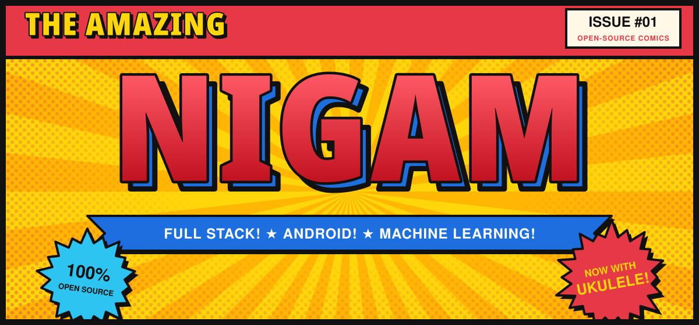

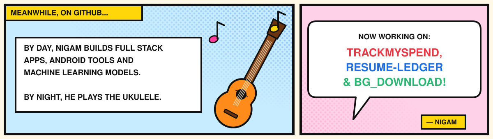

  <b>Full stack developer</b> · Android and machine learning · fun fact: I can play a ukulele. 
  Now working on <a href="https://github.com/nigmu/TrackMySpend">TrackMySpend</a>, <a href="https://github.com/nigmu/resume-ledger">resume-ledger</a> and <a href="https://github.com/nigmu/bg_download">bg_download</a>.

## Issue #01: the adventures

<table>
  <tr>
    <td width="50%" valign="top">
      <a href="https://github.com/nigmu/TrackMySpend">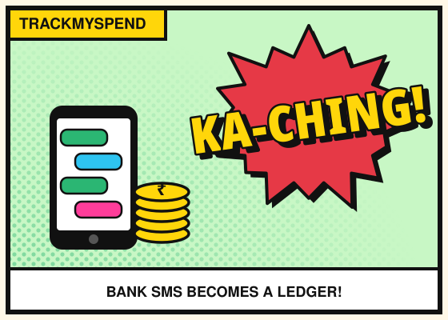</a>
      
<b><a href="https://github.com/nigmu/TrackMySpend">TrackMySpend</a></b>: FastAPI and PostgreSQL 
      service that records Android bank SMS 
      into a ledger, with a static web UI and 
      a Kotlin companion.

    </td>
    <td width="50%" valign="top">
      <a href="https://github.com/nigmu/resume-ledger">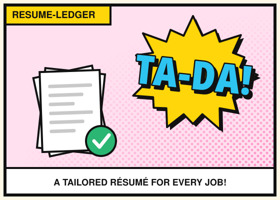</a>
      
<b><a href="https://github.com/nigmu/resume-ledger">resume-ledger</a></b>: Agent-driven system that 
      turns a career log into a tailored, 
      evidence-based Word and PDF resume for 
      each job.

    </td>
  </tr>
  <tr>
    <td width="50%" valign="top">
      
      
<b><a href="https://github.com/nigmu/odia-STT">odia-STT</a></b>: Tkinter desktop app that 
      records speech and transcribes Odia into 
      Unicode text with ElevenLabs Scribe v2.

    </td>
    <td width="50%" valign="top">
      <a href="https://github.com/nigmu/Clean_TV_MiTV-MOOQ0">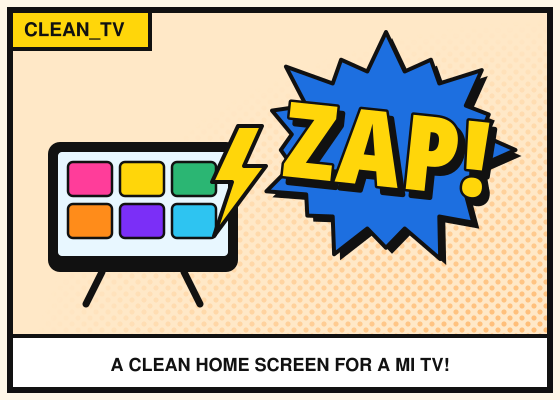</a>
      
<b><a href="https://github.com/nigmu/Clean_TV_MiTV-MOOQ0">Clean_TV_MiTV-MOOQ0</a></b>: Java Android TV 
      home screen and debloat tools for a 
      Xiaomi Mi TV (MiTV-MOOQ0).

    </td>
  </tr>
  <tr>
    <td width="50%" valign="top">
      <a href="https://github.com/nigmu/bg_download">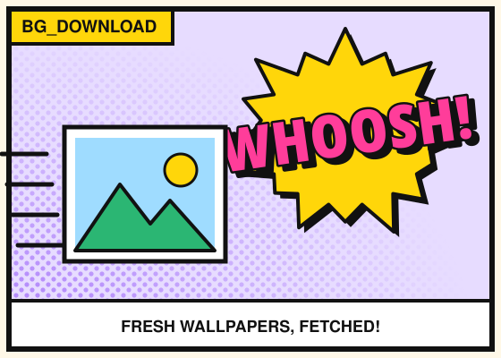</a>
      
<b><a href="https://github.com/nigmu/bg_download">bg_download</a></b>: Python tools that fetch 
      Wallhaven stills and replace KDE Plasma 
      live-wallpaper slots from Pixabay and 
      Coverr.

    </td>
    <td width="50%" valign="top">
      <a href="https://github.com/nigmu/warehouse_management">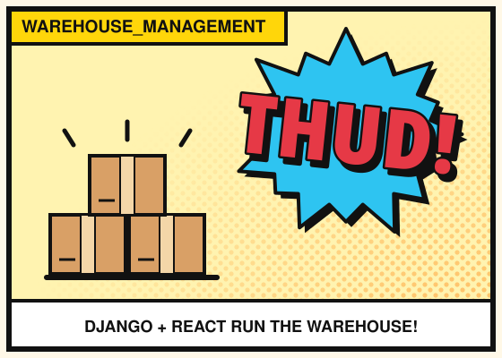</a>
      
<b><a href="https://github.com/nigmu/warehouse_management">warehouse_management</a></b> · 
      <a href="https://github.com/nigmu/WMS_DEPLOY_FRONTEND">WMS_DEPLOY_FRONTEND</a>: Django REST 
      framework and PostgreSQL backend for a 
      warehouse management system, with a 
      React, Vite, and Tailwind frontend.

    </td>
  </tr>
</table>

Bonus pages: notebooks and practice

 

[nigmu-parkinsons_disease_prediction](https://github.com/nigmu/nigmu-parkinsons_disease_prediction) — PyTorch notebooks that train a small CNN on healthy-control and Parkinson's images.

[neetcode-submissions](https://github.com/nigmu/neetcode-submissions) — Python solutions synced from NeetCode.io.

 

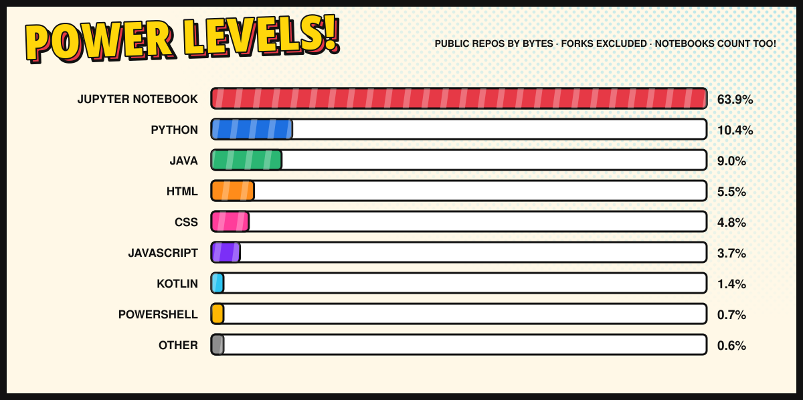

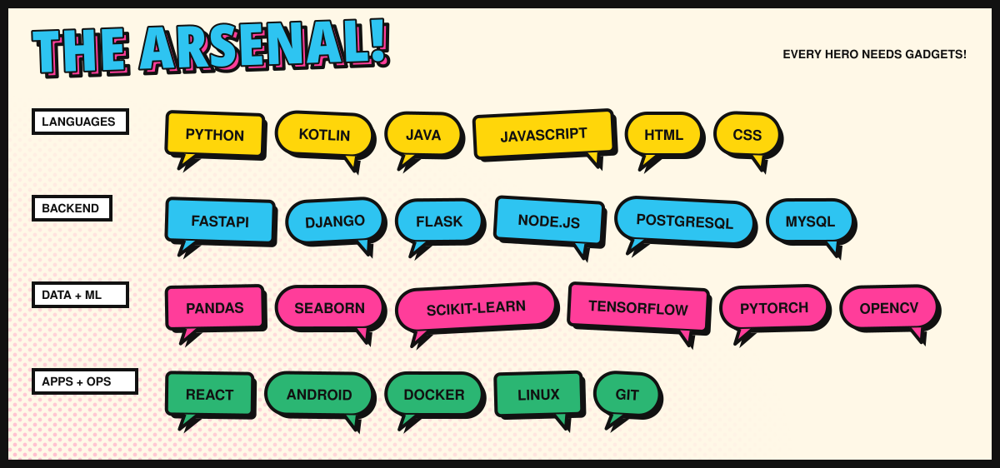

## Calling all sidekicks

Looking to collaborate on open-source projects. Ask me about Python and data analysis.

  
  <a href="https://x.com/nigmu7161">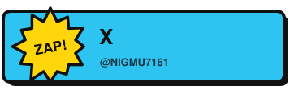</a>
  <a href="https://linkedin.com/in/nigamananda-behera">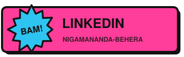</a>

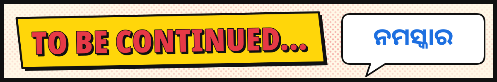
