<picture>
  <source media="(prefers-color-scheme: dark)" srcset="assets/hero-dark.svg">
  <source media="(prefers-color-scheme: light)" srcset="assets/hero-light.svg">
  
</picture>

<picture>
  <source media="(prefers-color-scheme: dark)" srcset="assets/tuner-dark.svg">
  <source media="(prefers-color-scheme: light)" srcset="assets/tuner-light.svg">
  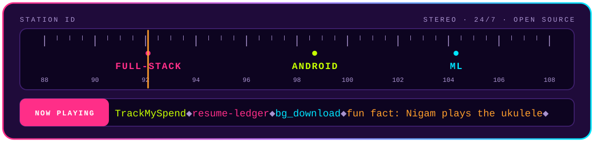
</picture>

  <b>Full stack developer</b>, broadcasting on Android and machine learning. 
  Now playing <a href="https://github.com/nigmu/TrackMySpend">TrackMySpend</a>, <a href="https://github.com/nigmu/resume-ledger">resume-ledger</a> and <a href="https://github.com/nigmu/bg_download">bg_download</a>. Fun fact: I can play a ukulele.

## On rotation

<table>
  <tr>
    <td width="50%" valign="top">
      <a href="https://github.com/nigmu/TrackMySpend">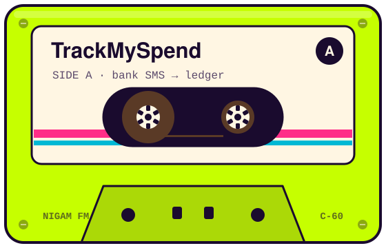</a>
      
FastAPI and PostgreSQL service that 
      records Android bank SMS into a ledger, 
      with a static web UI and a Kotlin 
      companion.

    </td>
    <td width="50%" valign="top">
      <a href="https://github.com/nigmu/resume-ledger">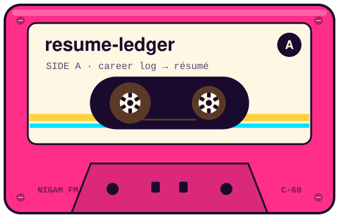</a>
      
Agent-driven system that turns a career 
      log into a tailored, evidence-based Word 
      and PDF resume for each job.

    </td>
  </tr>
  <tr>
    <td width="50%" valign="top">
      <a href="https://github.com/nigmu/odia-STT">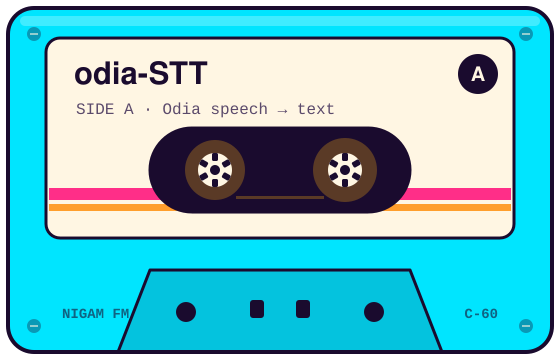</a>
      
Tkinter desktop app that records speech 
      and transcribes Odia into Unicode text 
      with ElevenLabs Scribe v2.

    </td>
    <td width="50%" valign="top">
      <a href="https://github.com/nigmu/Clean_TV_MiTV-MOOQ0">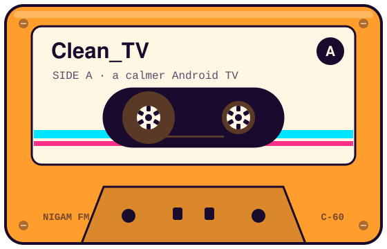</a>
      
Java Android TV home screen and debloat 
      tools for a Xiaomi Mi TV (MiTV-MOOQ0).

    </td>
  </tr>
  <tr>
    <td width="50%" valign="top">
      <a href="https://github.com/nigmu/bg_download">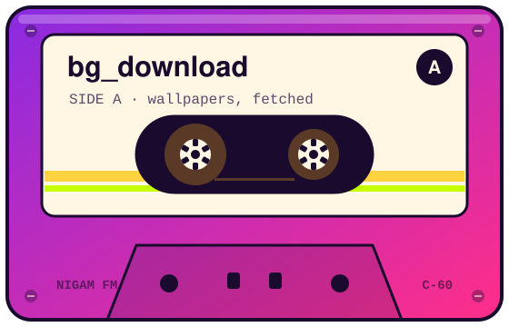</a>
      
Python tools that fetch Wallhaven stills 
      and replace KDE Plasma live-wallpaper 
      slots from Pixabay and Coverr.

    </td>
    <td width="50%" valign="top">
      <a href="https://github.com/nigmu/warehouse_management">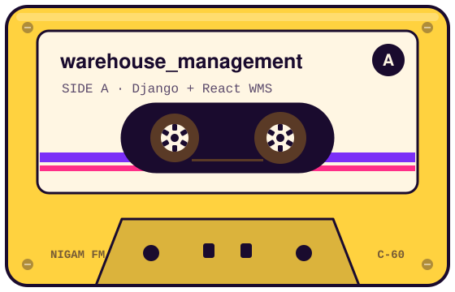</a>
      
Django REST framework and PostgreSQL 
      backend for a warehouse management 
      system, with a React, Vite, and Tailwind 
      frontend at <a href="https://github.com/nigmu/WMS_DEPLOY_FRONTEND">WMS_DEPLOY_FRONTEND</a>.

    </td>
  </tr>
</table>

B-sides: notebooks and practice

 

[nigmu-parkinsons_disease_prediction](https://github.com/nigmu/nigmu-parkinsons_disease_prediction) — PyTorch notebooks that train a small CNN on healthy-control and Parkinson's images.

[neetcode-submissions](https://github.com/nigmu/neetcode-submissions) — Python solutions synced from NeetCode.io.

## Levels

<picture>
  <source media="(prefers-color-scheme: dark)" srcset="assets/levels-dark.svg">
  <source media="(prefers-color-scheme: light)" srcset="assets/levels-light.svg">
  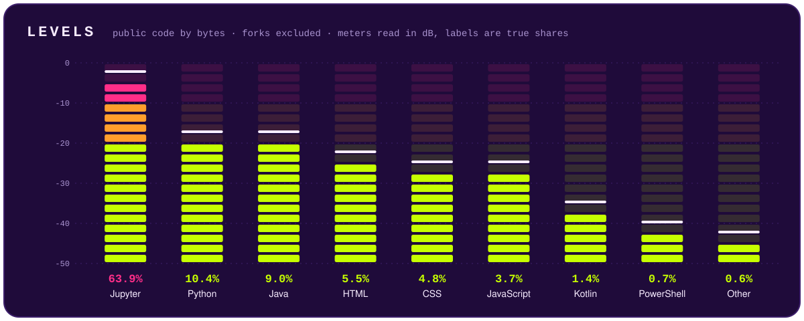
</picture>

Share of bytes in public repositories, forks excluded. The meters read in decibels like a mixing desk, so smaller languages stay visible; the percentages are the true shares.

## Patch bay

<picture>
  <source media="(prefers-color-scheme: dark)" srcset="assets/patchbay-dark.svg">
  <source media="(prefers-color-scheme: light)" srcset="assets/patchbay-light.svg">
  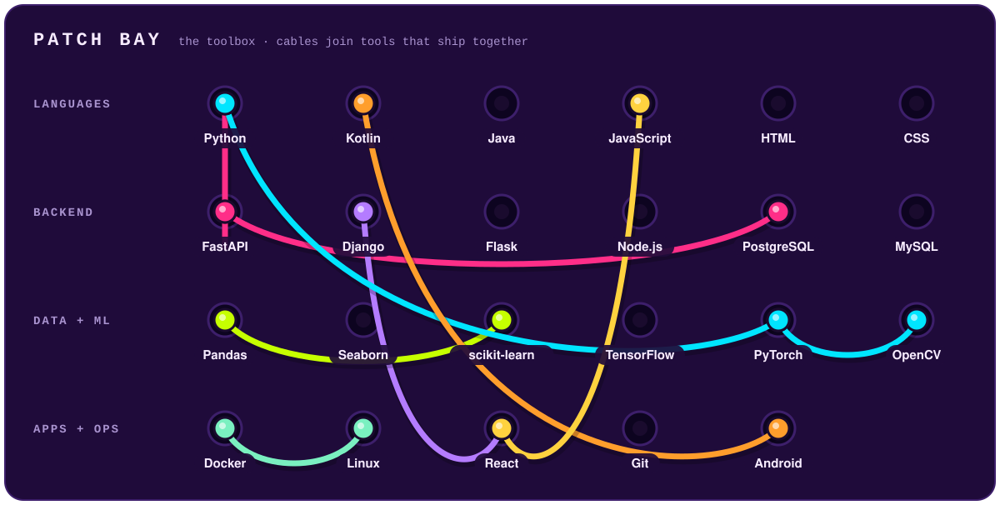
</picture>

## Request line

Looking to collaborate on open-source projects. Ask me about Python and data analysis.

  <a href="mailto:nigmucode@gmail.com">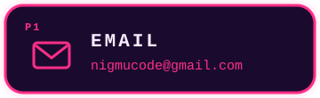</a>
  <a href="https://x.com/nigmu7161">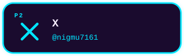</a>
  <a href="https://linkedin.com/in/nigamananda-behera">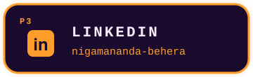</a>

<picture>
  <source media="(prefers-color-scheme: dark)" srcset="assets/signoff-dark.svg">
  <source media="(prefers-color-scheme: light)" srcset="assets/signoff-light.svg">
  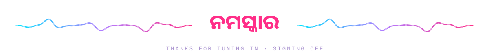
</picture>
