<picture>
  <source media="(prefers-color-scheme: dark)" srcset="assets/banner-dark.svg">
  <source media="(prefers-color-scheme: light)" srcset="assets/banner-light.svg">
  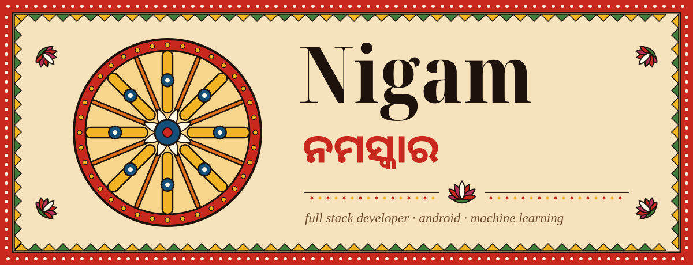
</picture>

  <b>Full stack developer</b> · Android and machine learning 
  Now working on <a href="https://github.com/nigmu/TrackMySpend">TrackMySpend</a>, <a href="https://github.com/nigmu/resume-ledger">resume-ledger</a> and <a href="https://github.com/nigmu/bg_download">bg_download</a>. 
  <i>Fun fact: I can play a ukulele.</i>

## Works

<table>
  <tr>
    <td width="50%" valign="top">
      <a href="https://github.com/nigmu/TrackMySpend"><picture>
        <source media="(prefers-color-scheme: dark)" srcset="assets/tiles/trackmyspend-dark.svg">
        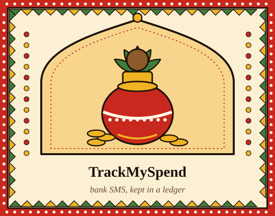
      </picture></a>
      
FastAPI and PostgreSQL service that 
      records Android bank SMS into a ledger, 
      with a static web UI and a Kotlin 
      companion.

    </td>
    <td width="50%" valign="top">
      <a href="https://github.com/nigmu/resume-ledger"><picture>
        <source media="(prefers-color-scheme: dark)" srcset="assets/tiles/resume-ledger-dark.svg">
        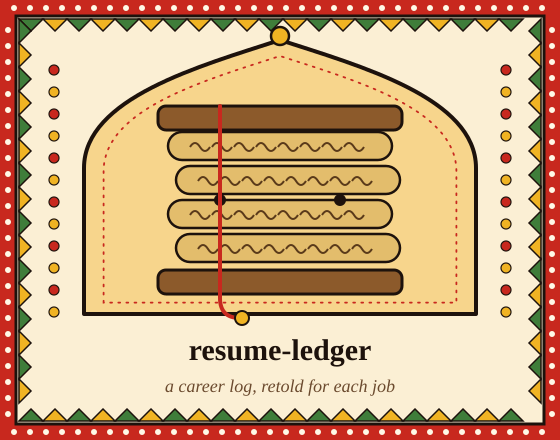
      </picture></a>
      
Agent-driven system that turns a career 
      log into a tailored, evidence-based Word 
      and PDF resume for each job.

    </td>
  </tr>
  <tr>
    <td width="50%" valign="top">
      <a href="https://github.com/nigmu/odia-STT"><picture>
        <source media="(prefers-color-scheme: dark)" srcset="assets/tiles/odia-stt-dark.svg">
        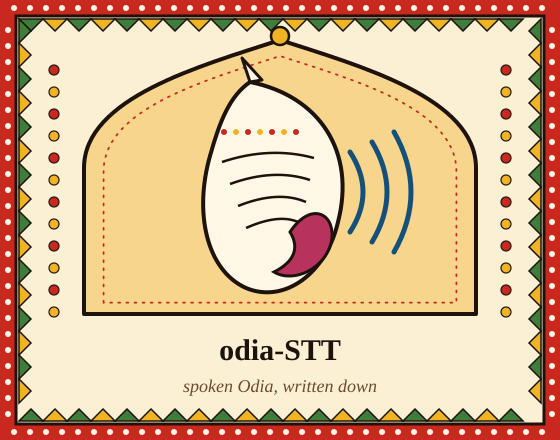
      </picture></a>
      
Tkinter desktop app that records speech 
      and transcribes Odia into Unicode text 
      with ElevenLabs Scribe v2.

    </td>
    <td width="50%" valign="top">
      <a href="https://github.com/nigmu/Clean_TV_MiTV-MOOQ0"><picture>
        <source media="(prefers-color-scheme: dark)" srcset="assets/tiles/clean-tv-dark.svg">
        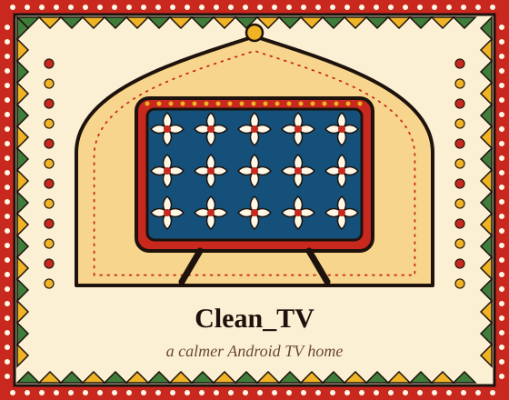
      </picture></a>
      
Java Android TV home screen and debloat 
      tools for a Xiaomi Mi TV (MiTV-MOOQ0).

    </td>
  </tr>
  <tr>
    <td width="50%" valign="top">
      <a href="https://github.com/nigmu/bg_download"><picture>
        <source media="(prefers-color-scheme: dark)" srcset="assets/tiles/bg-download-dark.svg">
        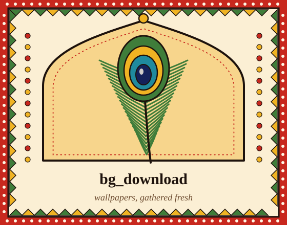
      </picture></a>
      
Python tools that fetch Wallhaven stills 
      and replace KDE Plasma live-wallpaper 
      slots from Pixabay and Coverr.

    </td>
    <td width="50%" valign="top">
      <a href="https://github.com/nigmu/warehouse_management"><picture>
        <source media="(prefers-color-scheme: dark)" srcset="assets/tiles/warehouse-dark.svg">
        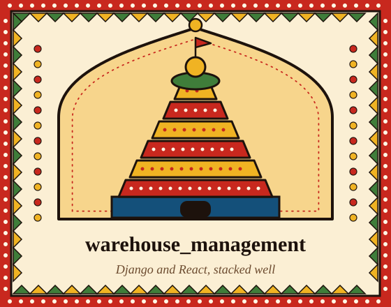
      </picture></a>
      
Django REST framework and PostgreSQL 
      backend for a warehouse management 
      system, with a React, Vite, and Tailwind 
      frontend at <a href="https://github.com/nigmu/WMS_DEPLOY_FRONTEND">WMS_DEPLOY_FRONTEND</a>.

    </td>
  </tr>
</table>

Sketches: notebooks and practice

 

[nigmu-parkinsons_disease_prediction](https://github.com/nigmu/nigmu-parkinsons_disease_prediction) — PyTorch notebooks that train a small CNN on healthy-control and Parkinson's images.

[neetcode-submissions](https://github.com/nigmu/neetcode-submissions) — Python solutions synced from NeetCode.io.

 

<picture>
  <source media="(prefers-color-scheme: dark)" srcset="assets/mandala-dark.svg">
  <source media="(prefers-color-scheme: light)" srcset="assets/mandala-light.svg">
  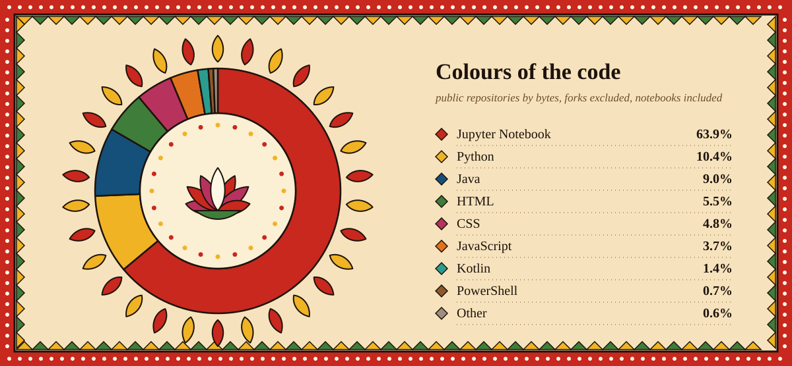
</picture>

<picture>
  <source media="(prefers-color-scheme: dark)" srcset="assets/garland-dark.svg">
  <source media="(prefers-color-scheme: light)" srcset="assets/garland-light.svg">
  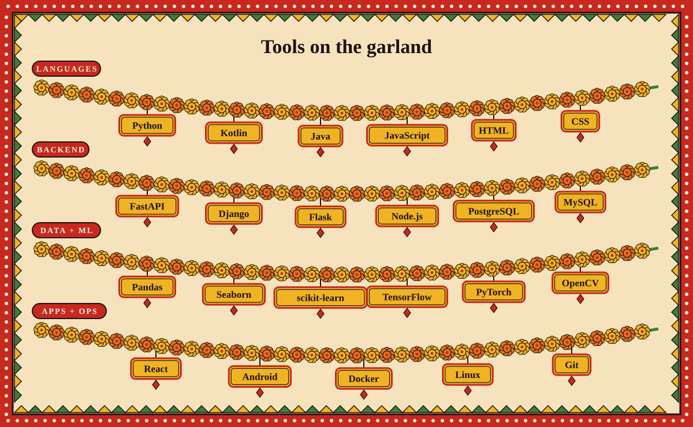
</picture>

## Write to me

Looking to collaborate on open-source projects. Ask me about Python and data analysis.

  
  <a href="https://x.com/nigmu7161">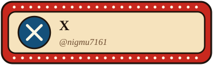</a>
  <a href="https://linkedin.com/in/nigamananda-behera">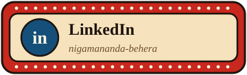</a>

<picture>
  <source media="(prefers-color-scheme: dark)" srcset="assets/namaskar-dark.svg">
  <source media="(prefers-color-scheme: light)" srcset="assets/namaskar-light.svg">
  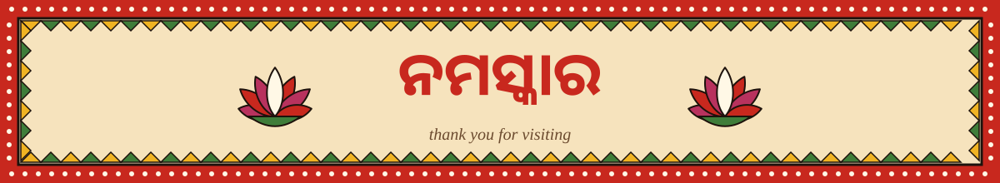
</picture>
